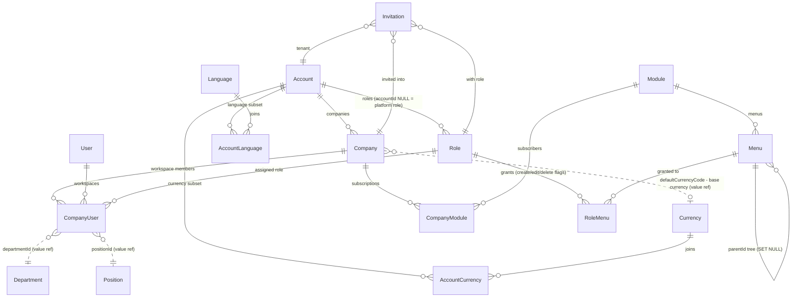
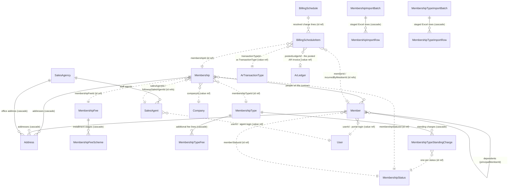
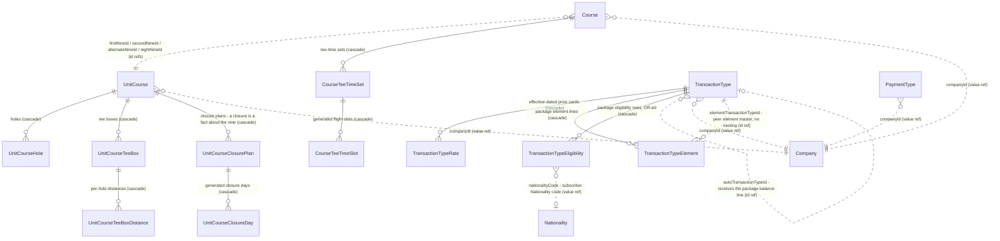
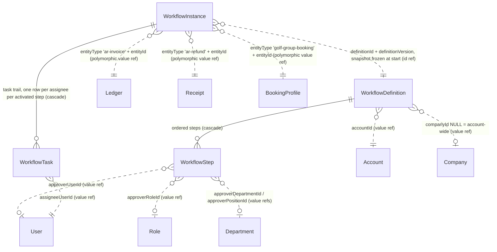
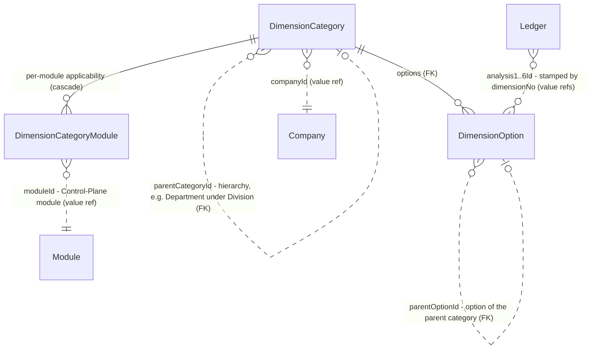
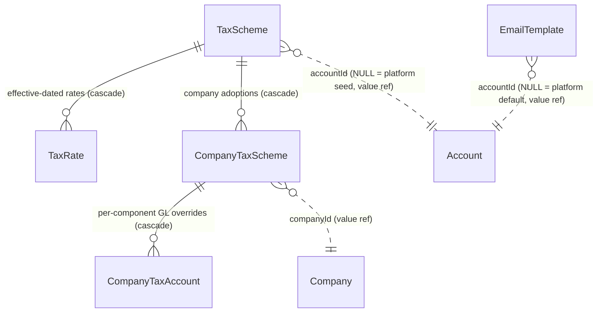

# Data Model

This doc is a curated map of the platform's database entities and relationships.
It is maintained by the `/data-model` skill - refresh it there, do not hand-edit it out of sync.
Sources of truth: `apps/api/src/wiring/associations.js` (all associations), the `*.model.js` files under `apps/api/src/modules/` and `apps/api/src/platform/` (all columns), and `apps/api/src/platform/schemas.js` (physical schemas).
Business context and golden rules: `apps/api/docs/systems/`.
Last refreshed: 2026-10-12.

## Conventions

- **One owner per table.**
  A service is the single source of truth for its data; nobody else writes it or points a DB-level FK at it (golden rules in `apps/api/docs/systems/README.md`).
- **Cross-service references are plain UUID/value columns** - no Sequelize association, no DB FK.
  In the ERDs below these are drawn as dashed lines labelled `(value ref)`.
  Some intra-service references are also plain id columns validated in the service (no association needed for eager-loading); those are dashed too, labelled `(id ref)`.
  Polymorphic references (a type column plus an id column, e.g. `Debtor.debtorType + sourceId`, `Golfer.golferType + sourceId`, `Allocation.creditDocType + creditDocId`) are always plain ids.
- **Real associations are intra-service FKs** - solid lines; `(cascade)` marks `onDelete: 'CASCADE'` header/detail pairs.
- **Postgres schemas**: each product/shared service owns its own schema - `membership`, `golf`, `tax`, `workflow`, `ar`, `dimension`, plus `audit` for the append-only trail (`facility` reserved).
  Platform tier tables (identity, saas control plane, notification, outbox) stay in `public`.
- **Frozen machine codes over display names**: `Module.code` (UPPER_SNAKE, globally unique, set at creation and never editable) is the identity every entitlement check, seed and route guard keys on; `name`/`names` are renamable display data.
- **Platform NULL-discriminator**: one table serves platform and subscribers; `accountId NULL` = the platform-owned row (`Role`, `EmailTemplate`, `TaxScheme`).
  `WorkflowDefinition` deliberately has no platform row; its `companyId NULL` means account-wide instead.
  The golf rule tables reuse the shape one level down: `courseId NULL` = the rule applies to every course, and the most specific matching rule wins.
- **Thin identity pair**: a product's party identity is one thin row with a polymorphic pointer at the profile source plus a golf-or-AR-owned profile master for people the club does not hold in Membership.
  `ar.Debtor` + `ar.OtherDebtor` and `golf.Golfer` + `golf.OtherGolfer` share the shape: `type + sourceId` (value ref, no FK), `name` / `memberNo` sort-key snapshots as the one deliberate denormalization, rows find-or-created lazily at first use, and a public person who joins the club is re-pointed to the member keeping the same id.
- **Money columns are `numeric(21,2)`**; percentages/rates keep their own precision (tax rate `DECIMAL(7,4)`, interest rate `DECIMAL(7,4)`, exchange rate `DECIMAL(21,10)`, handicap index `DECIMAL(4,1)`).
- **RBAC record stamps**: product tables carry `createdBy` / `createdByDepartmentId` / `updatedBy` so the data-scope rules (own/department/all) can be enforced.
  `createdBy NULL` on a product row means system-generated (outbox provisioning, billing/interest run, void reversal).
- **Staged holding pattern**: long-running batch work (membership import, fee run, interest run, statement run) generates into a header + detail pair, is reviewed, then posts selectively.
  Partial unique indexes (`WHERE status <> 'cancelled'` / `<> 'void'`) are the month duplicate guards, so a cancelled run can be regenerated.
- **Snapshots over joins**: posted documents freeze what they used (tax scheme/rate, exchange rate, party name/address, aging boundaries, golf bill tax breakdown, the crossover tee time of an 18-hole pair) so history never rewrites when a master changes.
- **Per-module numbering**: gapless document counters live beside the documents they number - `membership.NumberingScheme`, `ar.NumberingScheme` and `golf.NumberingScheme` share the `platform/numberingSchemeDef` shape and are reached through `platform/numberingGateway.js`, which routes by purpose prefix (`ar-*`, `golf-*`).

## Domain & schema map

| Module folder | Postgres schema | Service doc | Entities |
| --- | --- | --- | --- |
| `src/modules/identity` | `public` | [identity-auth.md](../apps/api/docs/systems/identity-auth.md) | User. Standalone: RefreshToken (session store), TrustedDevice (MFA skip) |
| `src/modules/saas` (Control Plane) | `public` | [system-administration.md](../apps/api/docs/systems/system-administration.md) | Account, Company, CompanyUser, Module, Menu, CompanyModule, Role, RoleMenu, Invitation, RegistrationLead, Language, Currency, AccountLanguage, AccountCurrency. Standalone: Country, IndustryType, Salutation, Nationality, Race, Title, PublicHoliday, CompanySmtpConfig, CompanyWeekendDay, UserFavorite, Department, Position, PlatformProfile (singleton), EInvoiceClassificationCode, EInvoiceMsicCode, EInvoiceTaxType, EInvoiceUnitType, EInvoiceStateCode, EInvoicePaymentMethod, EInvoiceDocumentType |
| `src/modules/notification` | `public` | [notification.md](../apps/api/docs/systems/notification.md) | Standalone: EmailTemplate, Notification (in-app bell) |
| `src/platform` | `public` | [notification.md](../apps/api/docs/systems/notification.md) | Standalone: OutboxMessage (transactional outbox queue) |
| `src/platform` | `audit` | - | Standalone: AuditLog (append-only, written only by the global hooks) |
| `src/modules/membership` | `membership` | [membership-management.md](../apps/api/docs/systems/membership-management.md) | Membership, Member, Address, MembershipFee, MembershipFeeScheme, MembershipType, MembershipTypeFee, MembershipTypeStandingCharge, SalesAgency, SalesAgent, MembershipImportBatch, MembershipImportRow, MembershipTypeImportBatch, MembershipTypeImportRow. Standalone: MembershipStatus, BillingSchedule, BillingScheduleItem, NumberingScheme, MembershipSetting (per-company singleton) |
| `src/modules/golf` | `golf` | [golf-management.md](../apps/api/docs/systems/golf-management.md) | Master files: UnitCourse, UnitCourseHole, UnitCourseTeeBox, UnitCourseTeeBoxDistance, UnitCourseClosurePlan, UnitCourseClosureDay (re-keyed from the course to the nine 2026-09-30), Course, CourseTeeTimeSet, CourseTeeTimeSlot, TransactionType, TransactionTypeRate, TransactionTypeElement, TransactionTypeEligibility. Booking and front desk: BookingProfile, Player, Bill, BillItem, BillPayment. Group bookings: GroupPlayDay, GroupFlight, GroupPlayer, GroupWaitlist, GroupRefund, GroupRefundItem. Id-ref documents (no associations): Golfer, OtherGolfer, NoShowCharge, BookingChange (one row per amendment of a flight booking, 2026-10-14), RainCheck (a golfer's single-use credit for an abandoned paid round, 2026-10-15), AffiliatedVisit (an incoming letter of introduction and the visit it authorises, 2026-10-15). Standalone: GolfSetting (per-company singleton), AdvanceBookingOverride, MinPlayerRule, GuestControlRule, HandicapLimitRule, HandicapAccompanimentRule, GolfSession, PaymentType, PlayerType (the player-category catalog whose code every line, rate default and rule carries, 2026-10-15), AffiliatedClub (the associations and reciprocal clubs whose members visit under a letter of introduction; playerTypeId value ref; referenced by OtherGolfer.affiliatedClubId, 2026-10-15), PlayingRightRule and RoundQuotaRule (whitelist and quota rows targeting a player type or an affiliated club, PUT-replaced with the Specification, 2026-10-15), NumberingScheme, FlightLock (short-lived tee-sheet claims) |
| `src/modules/tax` | `tax` | [tax.md](../apps/api/docs/systems/tax.md) | TaxScheme, TaxRate, CompanyTaxScheme, CompanyTaxAccount |
| `src/modules/workflow` | `workflow` | - | WorkflowDefinition, WorkflowStep, WorkflowInstance, WorkflowTask |
| `src/modules/dimension` | `dimension` | [dimension.md](../apps/api/docs/systems/dimension.md) | DimensionCategory, DimensionOption, DimensionCategoryModule (per-module applicability) |
| `src/modules/ar` (Account Receivable) | `ar` | [account-receivable.md](../apps/api/docs/systems/account-receivable.md) | All standalone (id refs validated in the service, no associations): TransactionType (the billing/receipting catalog, AR-owned since 2026-08-15), NumberingScheme, ExchangeRate (effective-dated FX rates vs the company base currency), Setting (per-company singleton), Debtor, OtherDebtor, CreditAccount, CreditMemberLimit, Ledger, TaxLedger, Receipt, Deposit, Allocation, Interest, InterestDetail, Statement, StatementDetail, StatementRun |
| `src/modules/facility` | `facility` (reserved) | [facility-management.md](../apps/api/docs/systems/facility-management.md) | none yet |

Standalone tables reference their owner (`accountId` / `companyId` / `userId`) by plain value and have no associations.
Pure bookkeeping standalones (sessions, reference lists, settings, rule rows, queues, locks) are kept out of the ERDs; standalone document tables whose id refs carry the business meaning (AR, billing runs, golfer identities, no-show charges) are drawn with dashed lines.

Numbering Control is split per module: `membership.NumberingScheme`, `ar.NumberingScheme` and `golf.NumberingScheme` share the `platform/numberingSchemeDef` shape, and the gapless counter lives beside the documents it numbers.
The golf table serves six `golf-*` purposes (booking, registration, bill, rain check, proforma, refund request).
The old `public."NumberingScheme"` table is the already-copied migration source and stays until dropped manually.

Eight models are not registered in `associations.js`: `TrustedDevice` (loaded by `trustedDevice.service.js`), `Department`, `Position` and `PlatformProfile` (loaded by their controllers and `platform/serviceContext.js`), `MembershipSetting` (loaded by `membershipSetting.service.js`), and the two import staging pairs, whose batch/row association is declared inside the row model file and loaded by the import services/controllers.
They still sync with the rest of the models because `app.js` requires every routes module at load time, before `sequelize.sync` runs at boot, and those routes pull in the controllers and services that define them.

## ERDs

### Control Plane & Identity

`RefreshToken` and `TrustedDevice` hang off `User.userId` by value only (identity-service session store and MFA trusted browsers); `UserFavorite` and `Notification` hang off `userId + companyId` the same way.
`Module.code` (added 2026-09-04) is the frozen machine identity (`MEMBERSHIP`, `GOLF`, `FACILITY`, `AR`, `POS`, `TENANT_ADMIN`, `PLATFORM_ADMIN`): entitlement checks, boot seeds, the dimension consumer registry and the web route guards key on it, never on the renamable names.

### Membership

Billing-item vocabulary (fee lines, standing charges, fee-run items) comes from the AR-owned `ar.TransactionType` catalog since 2026-08-15; rows reference it by id and resolve tax by code through the tax gateway seam.
The fee run (`BillingSchedule` + items) is the producer-side holding table: each posted item becomes exactly one AR Invoice through `platform/arGateway.js`.
Import staging rows keep every parsed column in JSONB (`data`) and lift only the linking keys into real columns; `migratedId` points at the real row a staged row became.
Golf reads this domain only through `platform/membershipGateway.js`: `MembershipType.isGolfAllow` (golfing right, never auto-charged a green fee) and `MembershipType.guestQuota` (guests per booking) are membership-type privileges the golf booking channel enforces, and `Member.memberKind` / `dependentType` / `principalMemberId` decide who counts as a junior.

### Golf

Golf is drawn as two diagrams of one domain: the master files, then the booking, front-desk and group-booking documents that reference them.

#### Golf - master files

The golf `TransactionType` is the golf billing-item master (tax by code via the seam); it is a different table from `ar.TransactionType`.
A package-class transaction type allocates its price across `TransactionTypeElement` lines and lists who qualifies for it in `TransactionTypeEligibility` rows (day of week, holidays, tee-off band, holes, age, gender, nationality - any row matching in full qualifies); the package's selling price stays on `TransactionTypeRate`.
`TransactionTypeRate` carries four neutral cells (9/18 holes by weekday/weekend) plus `flatAmount`; the golfer category moved onto the type as `TransactionType.golferType` (member / member-guest / guest), one active default per charge type and category.
Closure plans were re-keyed from the 18-hole course to the physical nine on 2026-09-30 (tables renamed from `CourseClosurePlan` / `CourseClosureDay`), because in a composite rotation closing one nine must block both the course that starts on it and the course that crosses over onto it.
`PaymentType` is the settlement-tender catalog (fixed `paymentClass` vocabulary: debtor / cash / member / voucher / staff / online / suspend / creditcard, plus the `deposit` class used on a group final bill).
`GolfSetting` is the per-company Golf Specification singleton (advance-booking window, merge rule, booking limits per day type, lock minutes, minimum players, guest / handicap / junior / no-show / group-booking controls, tee-sheet colours); the group-booking knobs are `groupBookingControlEnabled` (the master switch), `groupTentativeHoldHours`, `groupDepositDueDays`, `groupDefaultDepositPct`, `groupShareCapWeekday` / `groupShareCapWeekend`, `groupMaxTentativePerUser` and `groupNextInLineHours`; its sparse exception rows (`AdvanceBookingOverride.membershipTypeId` value ref into Membership, `MinPlayerRule`, `GuestControlRule`, `HandicapLimitRule`, `HandicapAccompanimentRule` with `courseId NULL` = every course, `GolfSession` time bands) and `GolfSetting.noShowTransactionTypeId` (id ref to a `no-show` transaction type) are PUT-replaced from that screen and stay out of the diagram.

#### Golf - booking, front desk and group bookings

```mermaid
erDiagram
    Golfer }o..|| Member : "golferType 'member' + sourceId (value ref)"
    Golfer }o..|| OtherGolfer : "golferType 'other' + sourceId (id ref)"
    BookingProfile ||--o{ Player : "players - one record per golfer per nine"
    Player ||--o| Player : "firstNinePlayerId - the crossover record of an 18-hole pair (one per pair)"
    Player }o..|| UnitCourse : "unitCourseId + teeTime - the nine-cell occupied, the availability key (id ref)"
    Player }o..|| Course : "courseId - the rotation course played (id ref)"
    Player }o..o| Golfer : "golferId - NULL while a name-only guest is merely booked (id ref)"
    BookingProfile }o..o| Golfer : "bookerGolferId (id ref)"
    BookingProfile }o..o| Course : "courseId - NULL for group types (id ref)"
    BookingProfile }o..o| WorkflowInstance : "workflowInstanceId - golf-group-booking approval (value ref)"
    BookingProfile }o..o| OtherDebtor : "debtorType + debtorSourceId - the billing party (polymorphic value ref)"
    BookingProfile ||--o{ GroupPlayDay : "play days, one course and start format each (cascade)"
    GroupPlayDay ||--o{ GroupFlight : "reserved flights (cascade)"
    BookingProfile ||--o{ GroupPlayer : "roster, one row per person (cascade)"
    BookingProfile ||--o{ GroupWaitlist : "queue entries (cascade)"
    GroupPlayDay ||--o{ GroupWaitlist : "queue entries for the day (cascade)"
    GroupPlayDay }o..|| Course : "courseId (id ref)"
    GroupFlight }o..|| UnitCourse : "unitCourseId + teeTime - the nine-cell held at full capacity (id ref)"
    GroupWaitlist }o..|| Course : "courseId + playDate - the queue key (id ref)"
    Player }o..o| GroupFlight : "groupFlightId - written by the draw (id ref, never cascades)"
    Player }o..o| GroupPlayer : "groupPlayerId - the roster row drawn (id ref)"
    GroupPlayer }o..o| Golfer : "golferId (id ref)"
    Bill ||--o{ BillItem : "items (cascade)"
    Bill ||--o{ BillPayment : "tenders (cascade)"
    Bill }o..o| Player : "playerId - per-player bill on the starting-nine record (id ref)"
    Bill }o..o| Golfer : "golferId (id ref)"
    Bill }o..o| BookingProfile : "bookingProfileId - group and deposit bills (id ref)"
    BillItem }o..|| TransactionType : "transactionTypeId / packageTransactionTypeId - tax snapshotted (id refs)"
    BillPayment }o..|| PaymentType : "paymentTypeId - class snapshotted (id ref)"
    BillPayment }o..o| ArLedger : "arDocId - the AR invoice posted for account classes (value ref)"
    BillPayment }o..o| Bill : "appliedDepositBillId - deposit-class tender draws on a settled deposit bill (id ref)"
    GroupRefund ||--o{ GroupRefundItem : "deposit bills drawn on (cascade)"
    GroupRefund }o..|| BookingProfile : "bookingProfileId (id ref)"
    GroupRefundItem }o..|| Bill : "depositBillId (id ref)"
    NoShowCharge }o..|| BookingProfile : "bookingProfileId - one row per penalised booking (id ref)"
    NoShowCharge }o..|| Golfer : "bookerGolferId - always the booker (id ref)"
    NoShowCharge }o..|| TransactionType : "transactionTypeId - the no-show type, tax snapshotted (id ref)"
    NoShowCharge }o..o| ArLedger : "arDocId - the posted AR invoice (value ref)"
    BookingChange }o..|| BookingProfile : "bookingProfileId - one row per amendment, changeNo 1..n (id ref)"
    BookingChange }o..o| NoShowCharge : "noShowChargeId - the late-change penalty raised with it (id ref)"
    RainCheck }o..|| Golfer : "golferId - the person owed, member or visitor (id ref)"
    RainCheck }o..|| Bill : "billId - the SETTLED source bill, one rain check each (id ref)"
    RainCheck }o..|| Player : "playerId - the registered starting-nine record (id ref)"
    RainCheck }o..o| Bill : "redeemedBillId - the later bill it paid (id ref)"
    BillPayment }o..o| RainCheck : "rainCheckId - raincheck-class tender redeems it (id ref)"
    AffiliatedVisit }o..|| AffiliatedClub : "affiliatedClubId - the visitor's home club (id ref)"
    AffiliatedVisit }o..o| Golfer : "golferId - the visitor's identity, set at confirmation (id ref)"
    AffiliatedVisit }o..o| BookingProfile : "bookingProfileId - the flight booking the confirmation created (id ref)"
    OtherGolfer }o..o| AffiliatedClub : "affiliatedClubId - a visiting member's home club (id ref)"
```

`Golfer` is the thin player identity every downstream row references (`golferId`, one shape for members and the public); the profile stays at the source (`Member` through the membership seam, or golf's own `OtherGolfer`), and `handicapIndex` / `handicapStatus` are the only golf-owned facts on it.
There is no materialized tee sheet: a day's grid is computed from the resolved `CourseTeeTimeSet`, minus closure days and group holds, overlaid with `Player` occupancy and unexpired `FlightLock` rows.
`BookingProfile` is the header only (booker, contact, remarks, lifecycle); the flight placement lives on `Player`, one record per golfer per nine, so an 18-hole play is a pair (`secondNineFlag` 0 = the starting-nine record carrying `registrationNo` and the bill, 1 = the crossover record pointing back through `firstNinePlayerId`) and a crossover landing on the nine another course starts on occupies that course's cell too.
`FlightLock` is the short-lived whole-flight claim while a booking is keyed (one row per nine-cell, unique per `companyId + unitCourseId + playDate + teeTime`, expiring after `GolfSetting.bookingLockMinutes`); it is a value-only table and stays out of the diagram.
Player lifecycle is booked -> registered -> cancelled / no-show; a walk-in is created directly as registered with `bookingProfileId NULL`.
`BookingProfile.bookingType` 'group' / 'tournament' turns the row into the group folio header: `GroupPlayDay` rows (own course, holes, start format - traditional / two-tee reserve nine-cells through `GroupFlight`, shotgun formats hold the course for a window), the `GroupPlayer` roster, and the draw, which writes ordinary `Player` pairs referencing the flight and roster row by plain ids so a re-draw never cascades into registration history.
The group lifecycle columns (`workflowInstanceId`, `holdExpiresAt`, `submittedAt`, `approvedAt`, `depositDueAt`, `depositRequiredAmount`, `confirmedAt`, `lapsedAt` + `lapseReason`, the once-per-clock warning markers `holdWarnedAt` / `depositWarnedAt`, the one manager extension `depositDueExtendedAt` / `depositDueExtendedBy` / `depositDueExtensionReason`, `isClubEvent`, `contactEmail`) are live only while `GolfSetting.groupBookingControlEnabled` is on; off, a group booking is booked at creation.
The tee sheet's hold state (TENTATIVE / PENDING / APPROVED) is derived from `status` by `groupLifecycle.service.js`, not stored.
`GroupWaitlist` (2026-10-11) is a tentative booking's place in the queue for a course on a date; it cascades with both the booking and the play day, and the first waiting entry is offered the freed day for `GolfSetting.groupNextInLineHours`.
`Bill.billType` is 'player' (one open bill per registered player on the starting-nine record), 'group' (the folio's single bill, printed as the proforma via `proformaNo` / `proformaRevision`) or 'deposit' (one Deposit item, settled on creation by its tender; `depositAppliedAmount` / `depositRefundedAmount` track its use).
The deposit is a golf bill, never an `ar.Deposit`: AR only ever sees normal invoices from golf.
`BillPayment` records multiple tenders until the sum equals the bill total; member / debtor classes post one AR invoice through `arGateway.postCharge` before the settle commits and snapshot it (`arDocId` / `arDocNo` / `debtorType` / `debtorSourceId`), and a deposit-class line on the group final bill names the deposit bill it draws on.
`GroupRefund` is the request to Finance for surplus deposit money (requested -> paid / declined, no workflow); its items reserve amounts on the deposit bills so the same money cannot settle the final bill and be refunded twice.
`NoShowCharge` is one row per penalised booking (reason 'no-show' from the desk review or 'late-cancel' from the booking cancel or a late change), always charged to the booker, priced from the `no-show` transaction type with a BillItem-shaped tax snapshot, and posted to AR after the business transaction commits (pending / posted / waived).
`BookingChange` (2026-10-14) is the visible history of an ordinary flight booking: one row per amendment with `changeNo`, `changeType` (move / roster / header / mixed), `before` and `after` JSONB snapshots of the flight, header and player lines, the confirmed `summary` sentence, the desk's `reason` and the penalty it raised; the booking number never changes, and the `Player` records themselves are re-pointed (moved), cancelled (dropped) or created (added) by the change.
`PlayingRightRule` and `RoundQuotaRule` (2026-10-15) carry plain value refs to a `PlayerType` or an `AffiliatedClub` (exactly one), an optional membership type and, for rights, a course; they stay out of the diagram like the other Specification rule tables.
`AffiliatedVisit` (2026-10-15, host side only) is the letter-of-introduction document: requested -> (pending-approval ->) confirmed or declined -> arrived -> completed, with cancelled and expired from any open state; its `facilities` JSONB carries the request, confirmation creates the visitor's `OtherGolfer` and an ordinary flight `BookingProfile` under them, and the desk's arrival stamps gate the party's registration.
`AffiliatedClub` (2026-10-15) holds the terms of each affiliate or reciprocal arrangement (agreement dates, visit and guest caps, charge-back and approval flags, contact and address) and names the affiliate-base `PlayerType` its visitors are billed as; a visiting member's `OtherGolfer` row points back at it through `affiliatedClubId` with their `affiliationNo` and card expiry, so their identity and history stay the one golfer shape.
`PlayerType` (2026-10-15) is the club's catalog of player categories; its `code` is a plain string key on `Player.playerType`, `GroupPlayer.playerType` and `TransactionType.golferType` (no association, so a code stays readable on history after the type is disabled), and its `baseIdentity` (member / member-guest / guest / affiliate) is the engine class the rules apply; three system rows per company carry the pre-master codes.
`RainCheck` (2026-10-15) is a golfer's credit for an abandoned paid round: issued against one settled `Bill` (value = the green-fee lines or the whole bill, prorated by the unplayed holes per `GolfSetting`), numbered from the `golf-raincheck` series, valid for `GolfSetting.rainCheckValidityDays`, and single use - the raincheck-class `BillPayment` line that redeems it records the amount applied and the surplus forfeited on the rain check itself (`redeemedAmount` / `forfeitedAmount`); the worker expires open ones past `expiryDate`.

### Account Receivable

```mermaid
erDiagram
    Debtor }o..|| Company : "companyId (value ref)"
    Debtor }o..|| Membership : "debtorType 'membership' + sourceId (value ref)"
    Debtor }o..|| Member : "debtorType 'member' + sourceId (value ref)"
    Debtor }o..|| OtherDebtor : "debtorType 'other' + sourceId (id ref)"
    Debtor ||..|| CreditAccount : "shared credit pool (id ref, unique debtorId)"
    Debtor ||..o{ CreditMemberLimit : "per-person caps (id ref)"
    CreditMemberLimit }o..|| Member : "memberId (value ref)"
    Debtor ||..o{ Ledger : "invoice / debit-note / credit-note (id ref)"
    Debtor ||..o{ Receipt : "receipt / refund (id ref)"
    Debtor ||..o{ Deposit : "security deposits (id ref)"
    Ledger }o..|| TransactionType : "transactionTypeId - tax snapshotted at posting (id ref)"
    Receipt }o..o| TransactionType : "transactionTypeId - receipt class (id ref)"
    TaxLedger }o..|| Ledger : "docType/docId (value ref)"
    Ledger }o..o| Ledger : "reversalOfId / applyToLedgerId (id refs)"
    Ledger }o..o| Member : "incurredByMemberId (value ref)"
    Ledger }o..o| WorkflowInstance : "workflowInstanceId (value ref)"
    Receipt }o..o| Deposit : "collectDepositId - the deposit paid into, or funding the refund (id ref)"
    Receipt }o..o| WorkflowInstance : "workflowInstanceId - refund rows only, ar-refund chain (value ref)"
    Allocation }o..|| Ledger : "credit or debit side 'ledger' (polymorphic id ref)"
    Allocation }o..|| Receipt : "'receipt' / 'refund' side (polymorphic id ref)"
    Allocation }o..|| Deposit : "'deposit' side (polymorphic id ref)"
    Interest }o..|| Debtor : "debtorId, one per month (id ref)"
    Interest ||..o{ InterestDetail : "overdue lines (id ref)"
    InterestDetail }o..|| Ledger : "chargeId - the overdue debit (id ref)"
    Interest }o..o| Ledger : "postedLedgerId - summary Debit Note (id ref)"
    Statement }o..|| Debtor : "debtorId, one live per month (id ref)"
    Statement ||..o{ StatementDetail : "frozen lines with running balance (id ref)"
    StatementDetail }o..|| Ledger : "docType + docId (polymorphic id ref)"
    Setting }o..o| TransactionType : "interest / depositConversion / fxGain / fxLoss type ids (id refs)"
    ExchangeRate }o..|| Company : "companyId (value ref)"
    ExchangeRate }o..|| Currency : "currencyCode - foreign currency (value ref)"
```

`Debtor` is the thin ledger account: the pointer runs one way (`debtorType + sourceId`), Membership/Member never carry a debtorId, and `debtorAccount` / `name` are sort-key snapshots only.
Hot balances are materialized on `CreditAccount.outstanding` and `CreditMemberLimit.personalUsed` (fixed lock order: pool row, then person rows) and asserted by reconciliation against `Allocation` rows.
Valid allocation pairs are `receipt -> ledger`, `ledger(credit) -> ledger(debit)`, `receipt -> deposit`, `deposit -> refund`, `receipt -> refund`; there is deliberately no `deposit -> ledger` pair.
Deposit value reaches outstanding only through the `deposit -> refund` offset since the separate Convert-to-Credit-Note door was removed (2026-09-02); `Setting.depositConversionTransactionTypeId` remains as a legacy column _(confirm)_.
`Ledger` and `Receipt` carry the draft lifecycle (`draft` / `pending-approval` / `open` / `settled` / `void`) with posting and void audit columns; receipts post directly, while refund rows (`Receipt.docType` 'refund', `refundMode` deposit / credit / offset) route through the `ar-refund` chain when one is active and name the deposit they draw on in `collectDepositId`.
Every `Ledger` row names its origin: `sourceModule` ('membership' | 'golf' | 'pos' | 'facility' | 'ar') plus `sourceRef`, so the fee run, a golf bill settlement, a golf deposit or a no-show charge is traceable from the receivable back to the producer row that posted it through `platform/arGateway.js`.
`TaxLedger` (added 2026-08-24) is the per-component tax breakdown behind a Ledger document's tax snapshot: `docType` mirrors `Ledger.docKind`, one row per rate line in `lineNo` computation order, frozen from the tax quote when the document's tax amounts are written and never re-derived.
Each row carries document-currency and base-currency amounts (at the document's frozen exchange rate), and `SUM(taxAmount)` always equals the parent `Ledger.taxAmount`.
`StatementRun` is the worker-driven job row (lease + progress counters) and has no business relationships, so it stays out of the diagram.
`ExchangeRate` (added 2026-08-21, step 1 of multicurrency AR) holds one rate per foreign currency per effective day; `rate` is how many base-currency units one foreign unit buys, looked up as the latest `effectiveDate <= docDate`.
Documents snapshot the rate they used plus base-currency equivalents (step 3), `Allocation.fxGainLoss` carries the realized gain/loss per pair in base currency (step 4), and `Interest`/`Statement` headers carry the debtor account's `currencyCode` (step 5) - editing a rate only changes future defaults.
The interest run supports pre-post maintenance: `InterestDetail.isExcluded` drops a line from the header totals until posting, and restore brings it back.
`Setting.multiCurrencyEnabled` gates foreign-currency Other Debtor accounts (currency per account, never per document); `fxGainTransactionTypeId` / `fxLossTransactionTypeId` designate the Forex-class catalog entries realized gain/loss posts under.

### Workflow

One definition per purpose per scope; routing variations live in step `condition` JSON, not in competing definitions.
The DB guarantees one live instance per document (partial unique on `entityType + entityId WHERE status = 'in-progress'`).
Products submit through `platform/workflowGateway.js`; the purpose catalog declares `membership-application`, `ar-invoice`, `ar-debit-note`, `ar-credit-note`, `ar-refund`, `ar-deposit` and `golf-group-booking`.
The producers whose documents carry a `workflowInstanceId` pointer back are the AR invoice (`Ledger`, approve auto-posts), the AR refund (`Receipt`) and the golf group booking (`BookingProfile`, approval starts the deposit clock; no chain configured means approved at once).

### Dimension (financial-analysis dimensions)

A company's category catalog is unlimited; assigning a category a dimension number 1..6 maps it onto consumers' `analysis<dimensionNo>Id` columns (`ar.Ledger` today, AP/GL/PO later), and the number is company-global so cross-module reporting joins on one column.
The repurpose lock: once any consumer document references one of a category's options, its `dimensionNo` can no longer change (renames stay free); the gateway's registered usage checks are the lock's eyes.
Applicability is opt-in per consuming module (`DimensionCategoryModule`; presence = offered, `isRequired` per module), and both hierarchy levels are stamped at save so history never rewrites when an option is reparented.
Consumers call through `platform/dimensionGateway.js`, registering by frozen `Module.code`.

### Tax & platform services

`OutboxMessage` is the standalone transactional-outbox queue drained by the worker; it has no relationships.
`AuditLog` (schema `audit`) is append-only and keyed by `tableName + recordId`; `userEmail` is denormalized so the trail outlives the user row, and `requestId` groups every row one HTTP request changed.
Products consume tax through `platform/taxGateway.js`, numbering through `platform/numberingGateway.js`, AR posting through `platform/arGateway.js`, approvals through `platform/workflowGateway.js`, member standing through `platform/membershipGateway.js`, and day-type classification (weekend days + public holidays) through `platform/calendarGateway.js` - seams, not associations.
